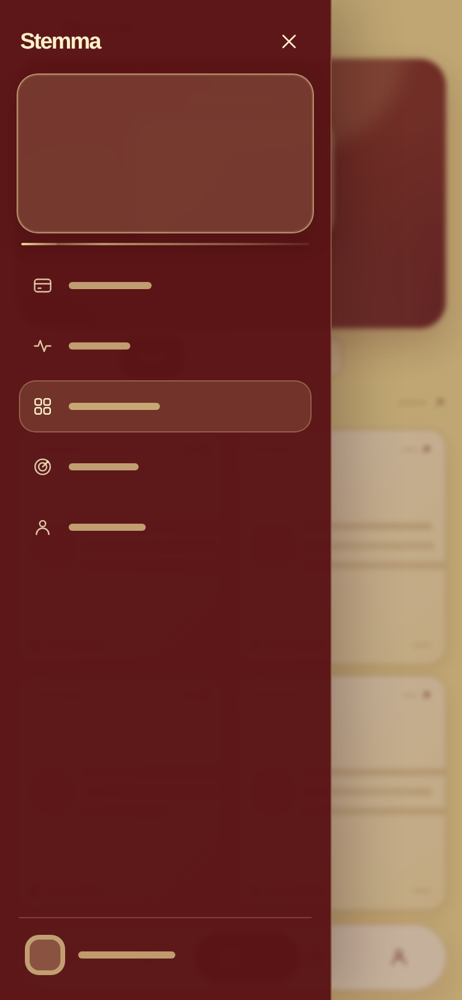

# Stemma

A responsive, mobile-first wallet dashboard prototype with a backend eSignet OpenID Connect sign-in flow. The dashboard remains a visual prototype: it does not connect to a bank, store wallet balances, or process financial data or transactions.

## Preview

Desktop:


Mobile:


Mobile sidebar:



## Run locally

Requires Node.js 20 or newer.

```bash
npm install
cp .env.example .env
```

Generate a local session secret and put the value in `.env`:

```bash
openssl rand -base64 48
```

Run the application backend and frontend together (the server reads `.env` when present; environment variables can also be supplied by the deployment):

```bash
npm start
```

Open <http://localhost:3000>. `Skip` remains available as a guest path and does not create an authenticated Fayda session. Fayda sign-in is unavailable until the environment contains Stemma's own registered partner-client configuration. The blank `.env.example` deliberately contains no client credentials or signing keys.

For UI-only preview without the backend, `python3 -m http.server 8000` still serves the static prototype; its Fayda button will explain that authentication needs the backend.

## Fayda eSignet configuration

Register Stemma as a relying party in the Fayda Partner Portal and use values issued for that specific environment. Do not use another application's demo client or private key. Configure these server-side environment variables (see `.env.example`):

- `FAYDA_ISSUER` — exact issuer for the selected sandbox or production environment. Discovery is derived as `{issuer}/.well-known/openid-configuration`, or can be set explicitly with `FAYDA_DISCOVERY_URL`.
- `FAYDA_CLIENT_ID` — Stemma's registered client ID.
- `FAYDA_CLIENT_PRIVATE_JWK_PATH` or `FAYDA_CLIENT_PRIVATE_JWK` — Stemma's registered RSA private JWK. Prefer a mounted secret file with mode `0600`; never commit it or expose it to the browser.
- `FAYDA_REDIRECT_URI` — exact callback URI registered for this client. Local development defaults to `http://localhost:3000/auth/fayda/callback`; production must use HTTPS.
- `SESSION_SECRET` — a unique random value of at least 32 bytes.
- `APP_ORIGIN` — public app origin; it must match the callback origin.

The initial scope is only `openid`. The integration intentionally sends no `claims`, requests no profile fields, and stores no Fayda tokens or returned profile data. `FAYDA_ACR_VALUES` and `FAYDA_UI_LOCALES` are optional and should remain unset unless Fayda confirms values for Stemma's registered client. The client assertion lifetime defaults to 60 seconds and can be set from 30–300 seconds with `FAYDA_ASSERTION_TTL_SECONDS`; confirm the accepted lifetime with Fayda.

The backend discovers the provider endpoints, enforces the configured issuer, and uses HTTPS endpoints. It implements authorization-code flow with per-attempt state, nonce, and S256 PKCE; server-side one-time transactions; private_key_jwt client authentication; RS256 ID-token and signed UserInfo verification; nonce and subject matching; session-ID rotation; HTTP-only, SameSite=Lax cookies; rate limits; and safe generic callback failures. Tokens, codes, assertions, provider error descriptions, and identity claims are not sent to browser storage or logged.

## Session storage and deployment

The default in-memory session store is for local development and automated tests only. It is not suitable for a production or multi-instance deployment. Production startup requires PostgreSQL connection variables (`DB_HOST`, `DB_PORT`, `DB_NAME`, `DB_USERNAME`, and `DB_PASSWORD`), an HTTPS `APP_ORIGIN`, and a strong `SESSION_SECRET`. The PostgreSQL session table is created automatically; database connections use TLS. Wasmer's managed PostgreSQL database injects the required `DB_*` variables when enabled in `app.yaml`.

Serve the app over HTTPS in production. Keep sandbox and production clients, keys, issuers, callback URIs, and secrets separate. Fayda sign-in remains unavailable until Stemma's own client ID, signing key, issuer, and registered callback are configured; no demo credentials are used. Configure the exact callback URI with Fayda before attempting a live sandbox round trip. Confirm PKCE support, client-assertion expiry, locale/ACR values, and signed UserInfo claims with Fayda; the public discovery and partner materials contain open discrepancies. This is eSignet sign-in, not e-KYC or financial identity verification.

## Tests and checks

```bash
npm test
npm run check
```

The automated authentication test uses a local mock OIDC provider and generated ephemeral keys; it never calls Fayda and contains no real credentials. It covers the authorization request, PKCE verification, client assertion, ID-token/UserInfo validation, state mismatch and replay rejection, session rotation, logout origin protection, and provider cancellation.

## UI features

- Responsive dashboard layout with mobile bottom navigation
- Cards, Activity, Overview, Goals, and Profile sections
- Hash-based section navigation, tab selection, drawer navigation, and touch-swipe navigation
- `Skip` guest access remains available
