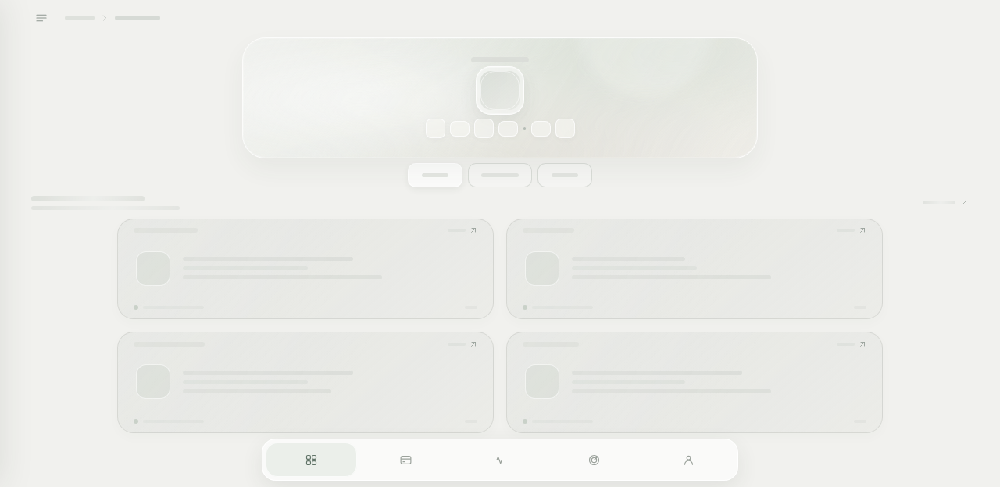
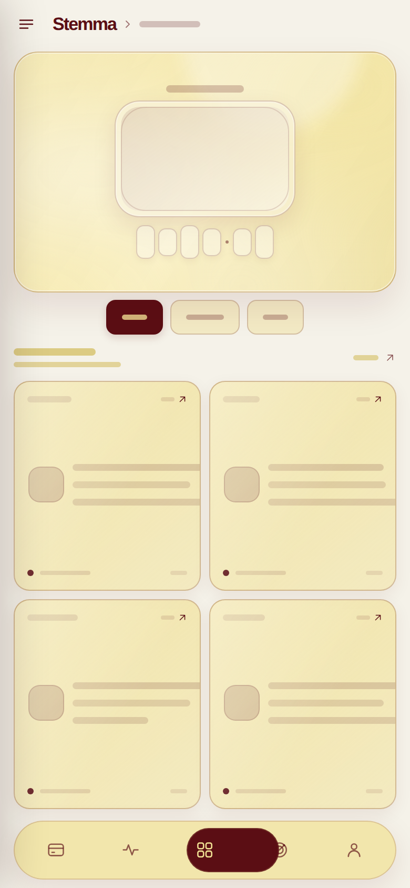

# Stemma

A responsive, mobile-first wallet dashboard UI prototype built with plain HTML, CSS, and JavaScript. The interface uses placeholder skeletons and sample navigation; it does not connect to a backend or process real financial data or transactions.

## Preview

Desktop:



Mobile:



## Run locally

From this directory, start a static web server:

```bash
python3 -m http.server 8000
```

Then open <http://localhost:8000>.

## Features

- Responsive dashboard layout with mobile bottom navigation
- Cards, Activity, Overview, Goals, and Profile sections
- Hash-based section navigation, tab selection, drawer navigation, and touch-swipe navigation
- No build step or third-party runtime dependencies
